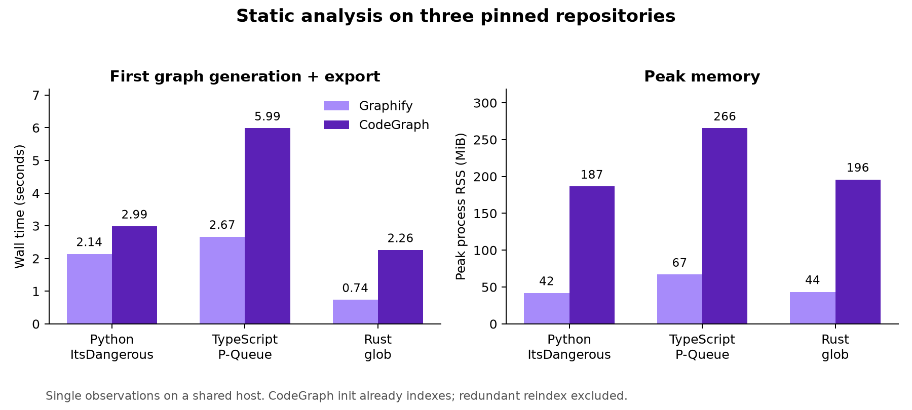
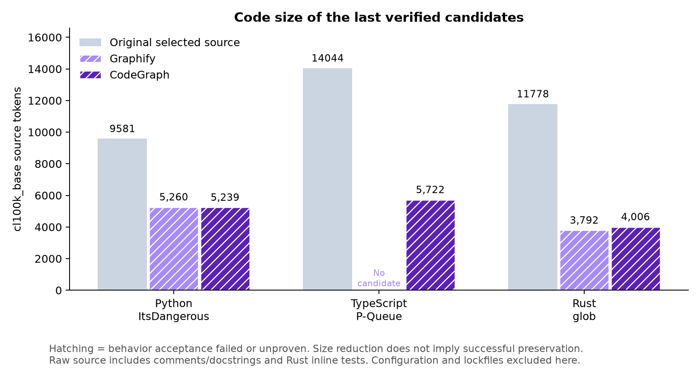

# Graphify 与 CodeGraph：nanolize 跨语言对照实验

实验日期：2026 年 11 月 6 日。状态：六组主对照已结束，结果含验收缺口。

## 当前判断

本轮尚无证据支持用 CodeGraph 全面替换 Graphify。静态建图方面，两者覆盖了选中的源文件；Graphify 在这三个小仓库的单次测量中更快、内存更低，人工检查还发现 CodeGraph 的两个错误调用目标。端到端方面，默认任务交接、修复反馈和计时测试的不稳定影响更大；失败候选的体积差异不足以证明图工具优劣。建议暂时保留 Graphify 为默认，把 CodeGraph 作为可选后端，先修复共同流程后再重复比较。这是当前证据下的工程判断，不是统计显著的胜负。

六组主对照共生成五份完成验收的候选，没有一份通过全部冻结功能验收；其中四份安装通过，P-Queue CodeGraph 安装失败。P-Queue Graphify 在原版基线阶段受阻，没有压缩候选。不能将此报告描述为已完成六份可用压缩版本的公平性能排名。

## 实验范围

比较固定的 main（8c0745a1，Graphify 0.9.100）与 codex/codegraph-understanding（d499ce45，CodeGraph 1.6.2）。两者重写、修复、任务评估逻辑一致；执行与评估文件仅增加分析产物的排除规则。所有实验均使用隔离分支，不修改原始仓库。

| 语言 | 仓库 | 保留功能 |
|---|---|---|
| Python | [pallets/itsdangerous @ 672971d6](https://github.com/pallets/itsdangerous/tree/672971d66a2ef9f85151e53283113f33d642dabd) | 字节签名、序列化、密钥轮换、时间戳与过期、URL-safe 与压缩载荷 |
| TypeScript | [sindresorhus/p-queue @ 7f272ab5](https://github.com/sindresorhus/p-queue/tree/7f272ab5ff2254c0dc2537b7977e88ede1cd55e8) | 并发与生命周期、优先级、自定义队列、取消、超时、固定与滑动窗口限流 |
| Rust | [rust-lang/glob @ 057cef28](https://github.com/rust-lang/glob/tree/057cef2824f5a96f738e52d7d8ca3e024381bcc6) | 模式解析、大小写/分隔符/隐藏文件选项、递归文件遍历、错误恢复 |

选择这三个规模可控、带成熟上游测试的项目，是为了覆盖 Python 继承与序列化、TypeScript 异步调度与类型、Rust 迭代器与文件系统。保留全部对外运行能力，包含多项可选工作流；只排除开发辅助脚本和单独的 benchmark/type-demo 文件。没有为达成体积目标删除失败功能。此样本不代表大型框架、C/C++ 或多语言单体仓库。

每对使用相同源码提交、功能选择、公共语义要求和冻结验收。默认目标为源码及配置 tokens 的 50%，仅作建议；功能失败默认继续修复，单次作者 60 分钟、整项任务 120 分钟。隐藏任务评估保持开启：modify 类型、3 次重复、并发 2、单次 15 分钟、最多 3 轮任务优化。使用现有配置中的 gpt-6-astra / xhigh，未替换模型。

Python/Rust 由第一组默认出题 Agent 生成任务；任务冻结后、候选代码产生前，将任务复制给另一组，仅转换不透明功能 ID。出题是共同准备成本，不能当作第二组节省：复用组的任务 token 上限与整项时限，分别扣除已完成的共同出题 tokens 与耗时，维持相同的百万 tokens / 120 分钟有效总预算。其他默认参数不变。两个过早启动且未扣除准备成本的测量已取消，记录作为额外实验准备开销保留。

例外：P-Queue 在初始 Node 22 试验中，CodeGraph 默认出题触发 900 秒超时，没有可用任务集，也没有完成的 usage 事件；Graphify 组因此独立走默认出题流程。恢复到 Node 24 后，两组也分别运行默认出题。P-Queue 的跨工具任务成本不作严格同题配对比较，功能/源码版本/验证条件仍固定。不能将超时调用的未知 tokens 当作零。

P-Queue 环境恢复：Node 22.6 下原版的计时断言和 advanced 测试文件多次不稳定，串行执行也未稳定解决；main 初始组在没有生成候选前停止。Node 24.22.2 下原版连续两次通过全部 280 项测试后，两种工具统一重启了 Node 24 对照。源码、验收命令与断言均未改变；Node 22 试验完整保留为环境诊断，不归因于图工具。Node 24 属于当前受支持的 LTS 系列，见 [Node.js 官方发布记录](https://nodejs.org/en/about/previous-releases)。

恢复后的 Graphify 组仍在原版验收出现 279/280 通过：长时间空闲后的限流间隔测为 77 ms，未满足上游断言。它没有进入重写，不能算作 Graphify 生成代码回归。CodeGraph 组的原版验收通过。两种 Node 版本均出现偶发计时失败，因此不能把更换 Node 视为已证明解决环境问题；已有失败基线和断言保持冻结。

Node 24 指宿主验收运行时。随后在 CodeGraph 作者日志中发现，作者使用的登录 shell 又解析到了系统 Node 22.6，npm 安装还发生 EAI_AGAIN，个别命令遇到嵌套沙箱挂载错误。冻结知识包仍提示 Node22，运行中没有修改它。这是运行环境一致性的限制，不能描述成所有 Agent 子命令都固定在 Node24，也不能将其归因于 CodeGraph 图质量。

运行中追加的停止规则：Python/Rust 四组在连续至少五次已验证尝试重复相同错误后，由宿主人工停止，未跑满默认两小时。这是事后加入的节约成本措施，两组实际尝试数曾不同；不修改默认程序、提示词或验收来制造通过。停止时的未完成调用可能缺少 usage。因运行被提前截断，不能推断完整预算下必然失败，也不能比较到达成功所需的时间。

TypeScript 另在 CodeGraph 第一份候选完成验收后停止继续修复：Graphify 对照已被原版计时基线阻塞，更多单边重试无法补齐这项可比性缺口。这也是事后人工停止，不是默认重试次数，更不是完整预算失败结论。原始运行、完整首轮验收和中断状态均保留。

## 原版验证与计量

原版 ItsDangerous 的 297 项测试通过；P-Queue 的 280 项上游 Node 测试（含生成声明的严格类型检查）和 TypeScript 编译通过；glob 的 18 项原版单元测试、文件系统集成测试及可运行文档测试通过。三个项目均通过独立安装验证。验收另外冻结了确定性输出检查。

glob 原本将单元测试写在实现文件内。为防止重写删除测试后虚增通过率，另将原版公共 API 测试冻结在验证命令中，在候选代码之外执行；仅将导入改为外部 crate，并移除一个检查私有优化字段 is_recursive 的断言，原有递归匹配行为断言全部保留。

| 仓库 | 选中实现 tokens | 配置 tokens | 选中合计 tokens |
|---|---:|---:|---:|
| itsdangerous | 9,581 | 90,493 | 100,074 |
| p-queue | 14,044 | 922 | 14,966 |
| glob | 11,778 | 3,723 | 15,501 |

默认口径包含依赖锁文件和源文件内测试。ItsDangerous 的配置/锁文件 tokens 占比很高，不能将其删除带来的总体下降描述为实现算法的同等简化。最终同时看实现与配置的变化。

程序的 50% 建议目标相对于完整原版计量：ItsDangerous 100,673、P-Queue 15,757、glob 15,501 tokens。上表是功能筛选后的计量；下文实现缩减率使用选中实现 tokens 作分母，避免把排除开发辅助脚本算作实现改写的收益。

源码口径还包含注释与文档字符串。glob 原版的 11,778 个源码 tokens 中，去除内嵌测试模块和仅测试使用的 doctest 调用后为 8,248；这是补充拆分，未改变默认目标或外部冻结测试。以这 8,248 个 tokens 为参照，可以避免将删除内嵌测试误当作生产实现的简化。

## 结构分析实测

| 仓库 | 工具 | 首次图生成及导出秒数 | 峰值 RSS MiB | 节点 / 边 | 选中源码文件覆盖 | 抽查调用命中 |
|---|---|---:|---:|---:|---:|---:|
| itsdangerous | graphify | 2.14 | 42.0 | 233 / 551 | 8/8 | 8/8 |
| itsdangerous | codegraph | 2.99 | 186.5 | 306 / 674 | 8/8 | 7/8 |
| p-queue | graphify | 2.67 | 67.0 | 201 / 377 | 5/5 | 8/8 |
| p-queue | codegraph | 5.99 | 265.5 | 399 / 2477 | 5/5 | 8/8 |
| glob | graphify | 0.74 | 43.5 | 107 / 178 | 1/1 | 8/8 |
| glob | codegraph | 2.26 | 196.0 | 112 / 324 | 1/1 | 8/8 |

这些是共享主机上的单次观测，不是隔离环境的性能基准。CodeGraph 的 init 已执行索引，额外强制重建的时间单独保存在证据中，不重复计入首次生成。Graphify 计时包含解释器启动、AST 提取、聚类与导出。两种工具的节点/边定义不同，数量不能直接比较准确率；上述文件覆盖表示图中存在文件相关节点，不代表全部符号/行为被正确理解。

人工核对了每种语言 8 条调用关系。该小样本不是随机抽样，不能估算全图准确率。另外发现两个 CodeGraph 误连：TimestampSigner.sign 的继承方法调用被连到 SigningAlgorithm.get_signature；glob_with 中标准库 Components.next 被连到项目自身 Paths.next。Graphify 在这两个例子中没有产生上述错误目标。两种图仍须进行人工语义审核。

另补查 TypeScript 调度、限流和事件等待中的 8 条私有方法调用，两者均为 8/8；这是后加的非随机样本，单列于 typescript-private-method-audit.json。CodeGraph 的原始边数包含同一函数对的重复调用位置；P-Queue 的 2,477 条边按起点/终点/类型去重后为 879 条（Graphify 为 377），不能直接解释为理解能力提升 6.6 倍。Python 去重后为 613 对 551，Rust 为 234 对 178。

CodeGraph 在 metadata 中提供数值 confidence 和 resolvedBy。当前适配层保守地把名称匹配等关系归为 ambiguous，较高分的其他解析归为 inferred，仅词法包含关系归为 extracted；没有将分数当作行为证明。Graphify 导出使用 EXTRACTED/INFERRED 等分类，含义与 CodeGraph 的数值不同。

经过当前功能映射后，两种工具各项目的功能关系条数相同：ItsDangerous 19、P-Queue 24、glob 12；差异主要保留在结构证据中。这限制了从单次下游重写差异推断图工具因果效果的能力。

## 压缩后分支

最近一次完成验收的候选（不包含中断时的输出）：

| 仓库 | 工具 | 尝试 | 功能状态 | 安装 | 实现 tokens | 配置 tokens | 实现 tokens 下降 |
|---|---|---:|---|---|---:|---:|---:|
| itsdangerous | graphify | 10 | regressed | passed | 5260 | 67 | 45.1% |
| itsdangerous | codegraph | 10 | regressed | passed | 5239 | 64 | 45.3% |
| p-queue | codegraph | 1 | regressed | failed | 5722 | 306 | 59.3% |
| glob | graphify | 7 | regressed | passed | 3792 | 2559 | 67.8% |
| glob | codegraph | 7 | regressed | passed | 4006 | 2571 | 66.0% |

失败候选的缩减率只描述生成代码体积，不代表功能保留成功，也不能作为选型胜出的依据。所有未完成、失败或缺失证据均保持原状态；未将未运行的验收记为通过。生成代码的功能、安装、tokens 和任务成本结果须结合各组最终证据判断。

Python 最后已验证候选：Graphify 为 296/297 测试通过，剩余问题涉及损坏时间戳的异常诊断；CodeGraph 缺少上游测试导入的私有函数 _lazy_sha1，导致三个测试文件收集失败。该收集阻塞不代表所有公开 API 都失败，也暴露出上游测试与私有实现的耦合。本轮保持冻结测试不变，不以补一个私有符号来事后改变验收结果。两组确定性签名/序列化输出检查及安装均通过。

Rust 两组均因缺少上游测试依赖 tempfile 而无法执行原生冻结测试，但安装检查通过。在不改动候选分支的临时验证副本中补齐原版测试依赖，并加 --no-fail-fast 执行全部两个测试目标后，两者均为公共单元测试 15/18 通过、文件系统集成测试失败：包括错误位置索引不符、递归匹配多返回根目录。这个补充诊断保持公共断言不变，但不替代原生验收；对应提交与环境改动另有记录。

TypeScript CodeGraph 的最后候选为 5,722 个源码 tokens，较选中原版 14,044 下降 59.3%；公共场景输出检查通过，但上游测试仍出现调度/取消行为与错误诊断不兼容，TypeScript 编译因 node:async_hooks 的 Node 类型配置失败，安装也失败。宿主验证环境已经提供 @types/node，不能把这个类型配置失败简单归为依赖未安装。

原生 TypeScript 验证驱动只保存末尾 18,000 字符，遗漏了完整计数。为补齐诊断，对相同提交、相同 Node24 环境和未改变的断言重跑，仅扩大日志捕获，得到 280 项中的 244 通过、34 失败、2 取消。该计数属于补充重跑；原生首轮验收结果和原版失败基线均未覆盖。

候选提交保留在实验记录中。本站公开汇总结果、固定的原版版本及方法说明；候选体积不表示功能验收成功。

## 模型调用成本与时间

| 项目 | 工具 | 实际墙钟分钟 | 作者调用已返回 / 已启动 | 作者 tokens | 出题/解题 tokens | 任务基线 |
|---|---|---:|---:|---:|---:|---|
| itsdangerous | graphify | 58.7 | 10 / 11 | ≥ 3,774,103 | 875,751 | unverified |
| itsdangerous | codegraph | 43.7 | 10 / 11 | ≥ 3,834,659 | 347,214 | unverified |
| p-queue | graphify | 15.4 | 0 / 0 | 未调用 | 1,419,597 | budget_exhausted |
| p-queue | codegraph | 30.5 | 1 / 2 | ≥ 831,365 | 1,195,633 | budget_exhausted |
| glob | graphify | 59.5 | 7 / 8 | ≥ 3,132,582 | 1,531,664 | unverified |
| glob | codegraph | 43.8 | 7 / 8 | ≥ 4,209,002 | 653,000 | unverified |

“≥”表示有未完成或缺失 usage 的调用，只能给出已观察下界。未进入作者阶段的组没有作者消耗，表中未知不表示其发生了作者调用。上表任务成本是各组实际发生的调用；Python CodeGraph 还应归入共同出题 442,826 tokens / 764.7 秒，Rust CodeGraph 应归入 730,730 tokens / 829.6 秒。共同出题在整个实验的实际支出中仅计算一次，不能当作 CodeGraph 的节省。墙钟时间包含失败/停止，不是成功完成流程所需时间。

默认 100 万 tokens 约束用于任务评估，不包含作者的重写和修复。预算在模型调用之间检查，单次调用可以超限：P-Queue 的 Node 24 出题 Graphify 为 1,419,597 tokens / 844.2 秒，CodeGraph 为 1,195,633 tokens / 868.5 秒；两者都在出题后耗尽任务预算，没有进入原版/压缩版的任务成本对照。

所有实际试验（含取消的准备运行和 Node 22 环境诊断）共记录模型 tokens：≥ 25,002,620；其中准备/环境诊断部分为 ≥ 3,198,050。这些数值不包含宿主协调、人工语义整理、下载/安装过程。逐次机器 usage 见 实验逐次调用记录（本地留存），未知值保持为空。

上述总量包含重复的缓存输入。已记录缓存输入为 22,485,376 tokens；它是输入总量的子集，不是额外相加的消耗。这里没有将缓存与非缓存 tokens 按相同价格折算成费用。

## 默认评估流程中观察到的问题

ItsDangerous 首次出题用时 764.7 秒，442,826 tokens，其中缓存输入 373,760；glob 首次出题用时 829.6 秒，730,730 tokens，其中缓存输入 632,448。P-Queue 初始 Node22 CodeGraph 组出题在 900 秒超时，usage 缺失。以上是自动调用的观测值，宿主的公共语义整理未计入。

Python 及 Rust 已观察到原版解题报告缺少 accept.py：出题文本要求解题者执行该检查，而默认流程仅在解题结束后的评审阶段写入私有检查。解题者按要求报告阻塞，任务基线因此标为 unverified；这属于任务设计与交付约定不一致，不是候选代码回归。原版及候选的正式功能验收保持独立。

同一 Python 原版、同题的首轮解题记录到 432,925 与 347,214 tokens，且均因上述问题阻塞。这种差异发生在尚未使用压缩代码时，说明不能将单次下游 token 差异直接归因于图工具。

修复反馈只给作者不透明的 check ID、退出码和相关功能集合，没有提供可定位问题的安全摘要。Python/Rust 的相同错误因此多轮重现。本轮没有把私有测试体、预期输出或源码回灌给作者来强行修过；建议另行改进错误分类和不含答案的诊断摘要。

宿主准备的共同语义包也不够完备：它覆盖了所选公开工作流，但没有逐项列出私有测试兼容符号、测试专用依赖和所有边界诊断规则。相同交接保证了两组输入可比，却不能保证交接充分。此次结果同时受到这个实验准备选择的影响，不能把失败全部归给图工具或默认 harness，更不能解释为两种工具的能力上限。

原版行为检查失败后，当前流程仍先运行昂贵的出题 Agent，之后才拒绝开始重写。应把原版验收通过检查移到出题前；同时澄清 solver 可访问的自测与评审侧私有 accept.py 的边界，加入无进展停止条件，并限制单次出题规模。这些是本轮证据支持的后续修改建议，未混入本次固定分支。

## 解释边界

- 主对照中每个项目/工具最多一条独立重写轨迹，P-Queue Graphify 因基线失败为零条；环境诊断的额外启动不算重复采样。配置中的 3 次任务重复也不等于 3 次独立重写。本轮没有形成有效的原版—候选—held-out 完整评估网格，不能证明压缩后的任务 tokens 改善。模型随机性、缓存与共享主机负载仍影响结果。
- 共同功能描述由宿主审核并固定，避免因主动删功能造成虚假压缩。这也意味着此实验未测量完全无人审核的图到需求生成质量、自动社区划分质量或功能树所需的人工整理时间。
- 测试通过仅支持已执行的行为；Linux 检查不证明 Windows 等平台完全等价。
- 输出 tokens 已包含供应商报告的推理量；输入 tokens 包含缓存命中。缓存 tokens 不应再加到总量上。出题、作者、解题、评审成本分列，缺少 usage 时保留未知。

## 版本与公开数据

分析分支固定为 main（8c0745a1）和 codex/codegraph-understanding（d499ce45）。上文链接指向三个项目的固定原版提交。

[下载公开结果 CSV](results.csv)。原始 Agent 日志、私有评估任务和本地运行目录不在公开网页中。
